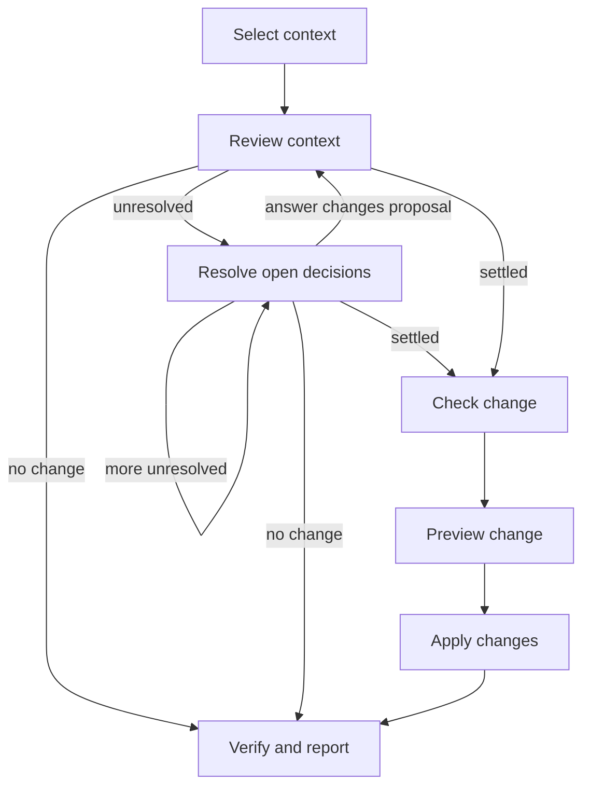

## Summary

Review and Refine Specifications

## Claim

### Mermaid Scheme

### Prose Claim

#### Input

`project_root`, `selection_sql`, `verification_sql`, `write_mode`, `task_instructions`, applicable model/query schema, `settled_decisions`, authorization and bound Workflow Run/Step context. The caller AI may construct and supply SQL; a human need not write it.

#### Output

Selection evidence, findings, proposal and mapping, accumulated decisions, Check and preview results, actual lifecycle and SQL change results, verification evidence, residual issues, no-change or explicit failure and any pending projection rebuild.

#### Step handoffs

| Step | Receives | Produces |
| --- | --- | --- |
| [Select context](CA-O-draft-PROJECT-WORKFLOW--review-and-refine-specifications/CA-O-draft-PROJECT-STEP--select-context.md) | `project_root`, `selection_sql` (caller AI may supply it), applicable query schema, and `approved_model_definition` when applying a model change. | One SELECT Run request using `project_root` and `selection_sql`. Return `selected_context`, per-statement results and selection evidence, or explicit failure. Select the complete requested Current and Draft specification context and relevant relationships. |
| [Review context](CA-O-draft-PROJECT-WORKFLOW--review-and-refine-specifications/CA-O-draft-PROJECT-STEP--review-context.md) | `project_root`, `selected_context`, selection evidence, `task_instructions`, applicable model/query schema, `approved_model_definition` when applying a model change, `settled_decisions`, prior proposal and mapping. | Return `findings`, `proposed_change_sql`, `write_mode`, `mapping`, and `requested_input` dictionary, or no-change/failure. Review findings and propose authorized Draft or in-place corrections. |
| [Resolve open decisions](CA-O-draft-PROJECT-WORKFLOW--review-and-refine-specifications/CA-O-draft-PROJECT-STEP--resolve-open-decisions.md) | `project_root`, bound Workflow Run and current Step, one-entry `requested_input` dictionary, `findings`, intermediate results and warnings; retain original selection, proposals, mapping and accumulated `settled_decisions`. | Return waiting response or correction dictionary. Merge only the answer to that question into `settled_decisions`; preserve original context, proposals and mapping. Present one unresolved question at a time. |
| [Check change](CA-O-draft-PROJECT-WORKFLOW--review-and-refine-specifications/CA-O-draft-PROJECT-STEP--check-change.md) | `project_root`, settled `proposed_change_sql`, `write_mode` and applicable schema; for consolidation, completed lifecycle results and the post-lifecycle mapping and current source state. | One Check request with that SQL and mode against the current source state; return per-statement validation results or failure, with no source effects. For consolidation this follows all lifecycle effects. |
| [Preview change](CA-O-draft-PROJECT-WORKFLOW--review-and-refine-specifications/CA-O-draft-PROJECT-STEP--preview-change.md) | `project_root`, checked `proposed_change_sql`, `write_mode`, settled mapping and current source state after any lifecycle effects. | One fresh preview request with that exact SQL and mode against the current source state; return per-change preview and per-statement results, or failure, with no apply. |
| [Apply changes](CA-O-draft-PROJECT-WORKFLOW--review-and-refine-specifications/CA-O-draft-PROJECT-STEP--apply-changes.md) | `project_root`, exact checked `proposed_change_sql`, `write_mode`, preview, authorized scope and settled decisions. | One apply request bound to the exact preview and SQL; return actual per-change and per-statement results, or explicit failure. No change means skip this Step. |
| [Verify and report](CA-O-draft-PROJECT-WORKFLOW--review-and-refine-specifications/CA-O-draft-PROJECT-STEP--verify-and-report.md) | `project_root`, caller-AI-supplied `verification_sql`, change results, accepted mapping and decisions. | One SELECT Run request using `verification_sql`; return per-statement results and evidence, or explicit failure. The Workflow compares these with expected findings and reports completed effects, residual issues and any required pending projection rebuild. |

#### Logical switches

Select then review. If `requested_input` is nonempty, bind one question to the additional-input Action and retain all context, proposals, mappings and prior answers. Ask the next unresolved question only after its predecessor is answered. If an answer changes the proposal, return to Review context to compile updated SQL and mapping; this is semantic clarification, not failure retry. When settled, Check the exact SQL, preview it in a separate request, and apply the exact authorized preview in a separate request. A no-change result skips write Steps and proceeds to verification. Verify with the supplied SELECT and report actual per-statement evidence and effects. Stop at failure without inferring rollback or retry. If a projection rebuild is required, report it pending until the existing builder is available and its result verified; no builder Action is asserted. This is a proposed Project Workflow definition, not an implemented Run.
