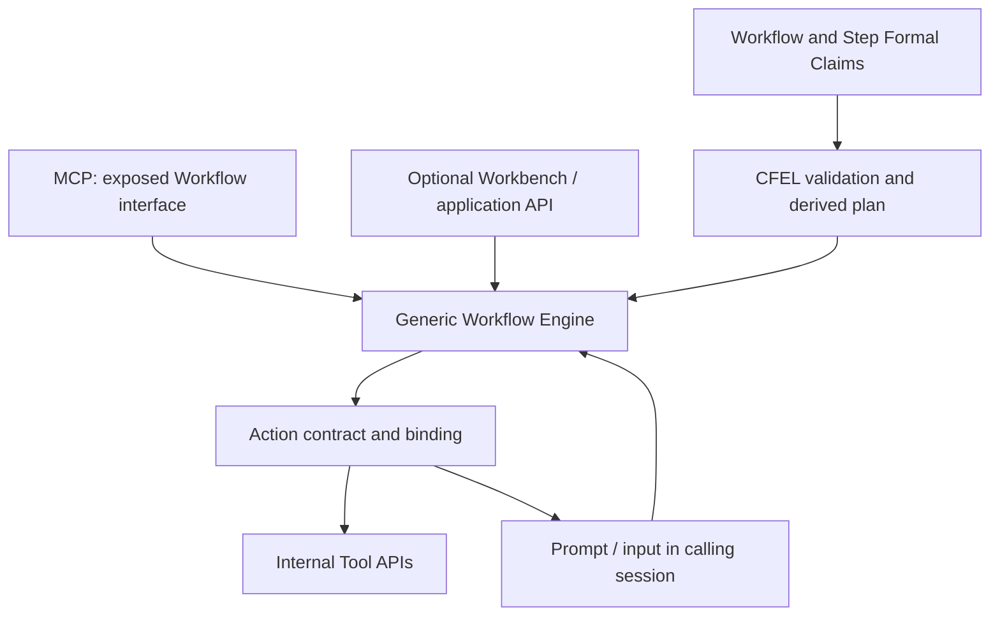

---
identity:
  atom_id: CA-M-draft
context:
  container:
    scope_unit: CA-SU-20
  role: Method
  form: Solution
  topics:
    main_subject: PROJECT STRUCTURE//CAPRMEDIO <+ Aspects <+ Engineering <+ Operation
      <+ Execution Control
  tier: 0
state:
  status: Draft
  version: 1
  updated_at: 2026-11-11 04:14:10 +0400
destination:
  file:
    name: CA-M-draft-APPS-SOLUTION--execute-formal-workflows-with-one-generic-engine.md
    path: .caprmedio_caprmedio/CA-SU-14_LAYER_2_FRAMEWORK_ENGINE/CA-SU-15_FEATURE_PROGRAMMATIC/CA-SU-20_FEATURE_APPS/05_method/000_draft/cfel-native-workflow-architecture
author: Anatoly Maslennikov
---

## Summary

Execute formal Workflows with one generic engine

## Claim

### Prose Claim

Use one generic Workflow Engine to validate and execute the plan derived from a formal Workflow definition. The engine owns Step dispatch, input/output binding, native decisions, nested Workflow calls, execution position and outcomes; Action implementations provide the actual business operations. A one-Action Workflow follows the same execution path as a larger Workflow.

## Semantics

Parse and validate the executable profile, resolve every contract and binding, then derive a typed execution plan. That plan is a rebuildable projection, not another source of truth. A new Workflow composed from already supported constructs and installed Actions does not require a new hand-coded runtime route. A new language semantic or implementation capability can still require engine or Tool code and image changes.

Bind a Run to the selected Project, Workflow/Step/Action definitions and their exact observed content hashes. Version alone is insufficient because accepted in-place source edits can preserve Version and Updated At. Continue an existing Run against its captured valid definition, not a silently replaced definition. New Runs resolve the newly selected sources under the applicable discovery policy.

In the initial execution profile, Steps run in defined order and only the selected branch executes. Await an asynchronous internal Tool through its API without blocking unrelated service requests. A nested call uses the same interpreter and binding rules. The interaction Method owns how a prompt/input boundary waits and continues; waiting is not successful completion.

On failure, stop the affected Run, return the explicit error and actual completed outputs/effects, and leave later Steps unexecuted. Do not add automatic retries, rollback, compensation or failure recovery. Invalid Project artifacts or requests produce attributable diagnostics and caller errors; runtime-integrity failures retain their separate blocking-error policy. Never report an uncertain effect as completed.

Keep current Run position and interaction correlation as runtime state. Business Journal entries observe started, waiting, failed, canceled and completed work; Journal completeness is not permission, effect proof or a recovery prerequisite. Technical diagnostics use the shared Docker stdout/stderr conventions. These stores do not become a competing source definition.

## Details

Proposed composition, summarized from the companion drafts:

The proposed WORKFLOW_ENGINE is an APP under APPS in the shared deployment. Its Scope Delegation must be adopted first; this Draft does not establish that unit. This replaces the architecture contract only after adoption and does not restore the retired Workflow Orchestrator implementation or its obsolete public APIs.

Use the existing multi-Project runtime and global Docker mount configuration. Bind every Run and data access to the trusted selected Project, preserve that binding across continuations, and keep Project state separate. Internal components call APIs directly; the MCP transport is the external Agent boundary. The optional UI is not required for execution. Existing Project-binding, resource-budget and error-handling policies remain applicable rather than being redefined here.
