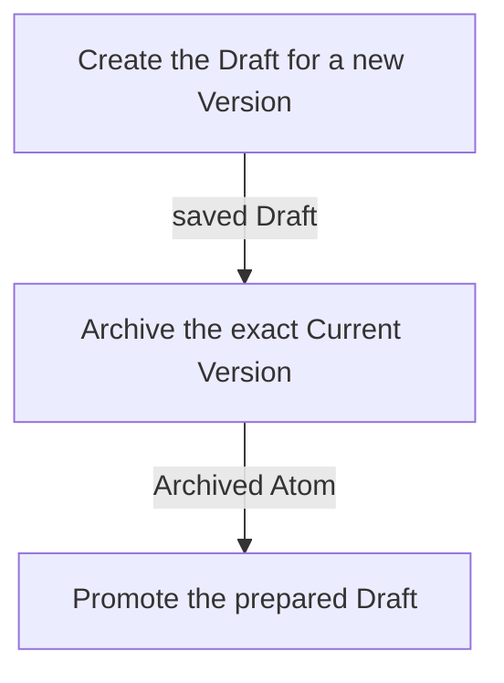

---
identity:
  atom_id: CA-O-10024
  ref_id: CA-O-10024@2
context:
  container:
    scope_unit: CA-SU-13
  role: Operations
  form: Workflow
  topics:
    main_subject: CAPRMEDIO_MODEL <+ Atom/(.Header.Context.Role := Operations)/Workflow/(.Purpose
      := Runtime)
    dependencies:
    - CAPRMEDIO_MODEL <+ Atom
    - CAPRMEDIO_STRUCTURE <+ Scope Unit//PROJECT_CONFIGURATION
  tier: 3
state:
  status: Archived
  version: 2
  updated_at: 2026-11-11 14:19:47 +0400
destination:
  file:
    name: CA-O-10024@2-PROJECT_CONFIGURATION-WORKFLOW--atom-lifecycle-update-atom.md
    path: .caprmedio_caprmedio/CA-SU-9_LAYER_1_FRAMEWORK_METHODOLOGY/CA-SU-10_SUPERLAYER_1_METHODOLOGY_SOURCES/CA-SU-13_LAYER_3_PROJECT_CONFIGURATION/09_operations/archived
relations:
  IS_REPLACEMENT_FOR:
  - CA-O-127
---
## Summary

Atom Lifecycle_Update Atom

## Claim scope

Composed lifecycle update in PROJECT_CONFIGURATION.

## Claim

### Mermaid Scheme

### Prose Claim

This Workflow's Purpose is Runtime; its scheme follows [CA-R-1570](../../CA-SU-11_LAYER_1_CORE_META_MODEL/04_requirement/CA-R-1570-CORE_META_MODEL-RULE--keep-workflow-graphs-separate-from-step-bindings.md).

#### Input

One exact `sourceCurrent` selector and requested property changes. Before Step 1, read the selected Current source once; bind its Status from the same read as internal `targetStatus`. A change to the Atom’s Scope Unit uses this same input. Derive the Draft and new Current placement from the destination Scope Unit and archive the exact predecessor under its original placement rules.

The `projectContext` input port binds the Project and applicable model.

Promotion skips a replacement target already archived by Step 2. This same-status binding applies only to this composed Update; generic Promote accepts any supplied allowed Current Status.

#### Output

Return `savedCurrentAtom`, `savedArchivedAtom` and `removedDraft` on success, including any additional targets archived by promotion. Return `requested_input` while waiting. On failure, return the error and all completed effects from the Steps already run. Return warnings separately.

#### Step handoffs

| Step | Receives | Produces |
| --- | --- | --- |
| [Create the Draft for a new Version](./CA-O-10024-PROJECT_CONFIGURATION-WORKFLOW--atom-lifecycle-update-atom/CA-O-10020-PROJECT_CONFIGURATION-STEP--create-the-draft-for-a-new-version.md) | `sourceCurrent`, requested changes, `projectContext` | `savedDraft`, `requested_input`, warnings, intermediate results, or a failure result |
| [Archive the exact Current Version](./CA-O-10024-PROJECT_CONFIGURATION-WORKFLOW--atom-lifecycle-update-atom/CA-O-10019-PROJECT_CONFIGURATION-STEP--archive-the-exact-current-version.md) | original `sourceCurrent`, warnings, and `projectContext` | `savedArchivedAtom`, warnings, or a failure result |
| [Promote the prepared Draft](./CA-O-10024-PROJECT_CONFIGURATION-WORKFLOW--atom-lifecycle-update-atom/CA-O-10021-PROJECT_CONFIGURATION-STEP--promote-the-prepared-draft.md) | `savedDraft`, captured `targetStatus`, `savedArchivedAtom`, warnings, and `projectContext` | the Promote Draft result, including any additional archived targets, completed effects or `requested_input` as applicable |

#### Logical switches

| Condition | Behavior |
| --- | --- |
| Entry | Run Create the Draft for a new Version. |
| Step 1 returns nonempty `requested_input` | Keep this Workflow pending; corrections resume Step 1 with captured `targetStatus` preserved. |
| Step 1 returns `savedDraft` | Run Archive the exact Current Version. |
| Step 2 returns `savedArchivedAtom` | Run Promote the prepared Draft. |
| Step 3 returns nonempty `requested_input` | Keep this Workflow pending. Resume the pending promotion with its original `targetStatus` and completed effects. |
| Step 3 returns `savedCurrentAtom` and `removedDraft` | Complete successfully. |
| A failure result is returned | Stop and report the explicit failure. |
