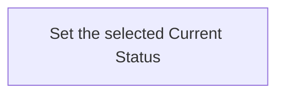

---
identity:
  atom_id: CA-O-10011
  ref_id: CA-O-10011
context:
  container:
    scope_unit: CA-SU-13
  role: Operations
  form: Workflow
  topics:
    main_subject: CAPRMEDIO_MODEL <+ Atom/(.Header.Context.Role := Operations)/Workflow/(.Purpose
      := Runtime)
    dependencies:
    - CAPRMEDIO_MODEL <+ Atom
    - CAPRMEDIO_STRUCTURE <+ Scope Unit//PROJECT_CONFIGURATION
  tier: 3
state:
  status: active
  version: 3
  updated_at: '2026-11-11T21:49:24+04:00'
destination:
  file:
    name: CA-O-10011-PROJECT_CONFIGURATION-WORKFLOW--atom-lifecycle-change-current-status.md
    path: .caprmedio_caprmedio/CA-SU-9_LAYER_1_FRAMEWORK_METHODOLOGY/CA-SU-10_SUPERLAYER_1_METHODOLOGY_SOURCES/CA-SU-13_LAYER_3_PROJECT_CONFIGURATION/09_operations
relations:
  IS_REPLACEMENT_FOR:
  - CA-O-127
---
## Summary

Atom Lifecycle_Change Current Status

## Claim scope

The invocation domain of [Set one Current Atom Status](CA-O-10007-PROJECT_CONFIGURATION-ACTION--set-one-current-atom-status.md).

## Claim

### Mermaid Scheme

### Prose Claim

This Workflow's Purpose is Runtime; its scheme follows [CA-R-1570](../../CA-SU-11_LAYER_1_CORE_META_MODEL/04_requirement/CA-R-1570-CORE_META_MODEL-RULE--keep-workflow-graphs-separate-from-step-bindings.md).

#### Input

One exact Current Atom selector and requested `targetStatus`. For a folder-backed parent, apply the containment cascade under CA-R-1521, CA-D-461 and CA-D-467 using separate one-Atom invocations.

To reopen a Done or Canceled Plan to an admitted nonterminal Current Status or to Backlog, change the parent first. Then change the selected latest Plans from outermost to innermost, changing each Plan before its children.

To move a Plan to Done or Canceled, apply the cascade to descendants before the parent. Preserve recursively contained latest Plans already Done or Canceled and request Canceled for the other contained latest Plans.

Stop at the first failure and report completed effects and remaining targets.

The `projectContext` input port binds the Project and applicable model.

#### Output

The `savedCurrentAtom`, warnings, and failure result.

#### Step handoffs

| Step | Receives | Produces |
| --- | --- | --- |
| [Set the selected Current Status](./CA-O-10011-PROJECT_CONFIGURATION-WORKFLOW--atom-lifecycle-change-current-status/CA-O-10010-PROJECT_CONFIGURATION-STEP--set-the-selected-current-status.md) | selected Atom, `targetStatus`, and `projectContext` | `savedCurrentAtom`, warnings or a failure result |

#### Logical switches

| Condition | Behavior |
| --- | --- |
| Entry | Run Set the selected Current Status. |
| `savedCurrentAtom` is returned | Complete successfully. |
| A failure result is returned | Stop and report the explicit failure. |

If an Action requests additional input, return its short explanation and requested input dictionary and keep the Workflow pending. Resume with the supplied dictionary; cancellation is allowed while waiting and does not interrupt an Action.
