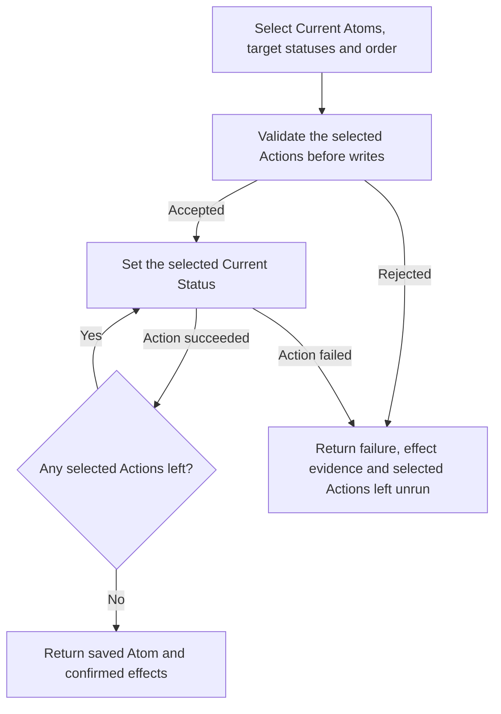

---
identity:
  atom_id: CA-O-10011
  ref_id: CA-O-10011
context:
  container:
    scope_unit: CA-SU-13
  role: Operations
  form: Workflow
  topics:
    main_subject: CAPRMEDIO_MODEL <+ Atom/(.Header.Context.Role := Operations)/Workflow/(.Purpose
      := Runtime)
    dependencies:
    - CAPRMEDIO_MODEL <+ Atom
    - CAPRMEDIO_STRUCTURE <+ Scope Unit//PROJECT_CONFIGURATION
  tier: 3
state:
  status: active
  version: 4
  updated_at: '2026-11-12T07:10:31+04:00'
destination:
  file:
    name: CA-O-10011-PROJECT_CONFIGURATION-WORKFLOW--atom-lifecycle-change-current-status.md
    path: .caprmedio_caprmedio/CA-SU-9_LAYER_1_FRAMEWORK_METHODOLOGY/CA-SU-10_SUPERLAYER_1_METHODOLOGY_SOURCES/CA-SU-13_LAYER_3_PROJECT_CONFIGURATION/09_operations
relations:
  IS_REPLACEMENT_FOR:
  - CA-O-127
---
## Summary

Atom Lifecycle_Change Current Status

## Claim scope

The invocation domain of [Set one Current Atom Status](CA-O-10007-PROJECT_CONFIGURATION-ACTION--set-one-current-atom-status.md).

## Claim

### Mermaid Scheme



### Prose Claim

This Runtime Workflow accepts one exact Current Atom selector and an allowed Current `targetStatus`. The Engine binds the Project and applicable model and supplies a pinned Current tree. Attached Drafts stay outside the cascade.

Run one Action per selected Atom. Enter shared Plan Backlog and reopen terminal Plans parent first. Moving a Backlog Plan to Active also activates every Current contained Task parent first. Otherwise, process descendants before the parent. To close a Plan to Done or Canceled, preserve terminal descendants and set the other Current descendants to Canceled. Each Action checks the model and source and derives the destination. The Workflow changes neither Version nor Updated At.

Return the saved Atom reference and confirmed effects on success. Report rejected fields before any write. At the first Action failure, return the failed Action, the reason, confirmed and uncertain effects, and any selected Actions left unrun.

### Formal Claim

```python
def change_current_status(*, invocation, engine):
    tree = engine.read_status_tree()
    requested_status = invocation.target_status.casefold()
    parent_status = tree.parent.status.casefold()
    terminal = {"done", "canceled"}
    entering_backlog = tree.is_plan and tree.shared_backlog and requested_status == "backlog"
    reopening = tree.is_plan and (
        (parent_status in terminal and requested_status not in terminal | {"draft", "archived"})
        or (parent_status == "backlog" and requested_status == "active")
    )
    parent_first = entering_backlog or reopening
    ordered_atoms = reversed(tree.child_first) if parent_first else tree.child_first
    closing = tree.is_plan and requested_status in terminal
    actions = []
    for atom in ordered_atoms:
        closing_child = closing and atom.atom_id != tree.parent.atom_id
        if closing_child and atom.status.casefold() in terminal:
            continue
        actions.append((atom.atom_id, "Canceled" if closing_child else invocation.target_status))
    engine.preflight(actions=actions, parent_first=parent_first,
                     entering_backlog=entering_backlog, reopening=reopening)
    for atom_id, selected_status in actions:
        if not engine.invoke(step="CA-O-10010@1", action="CA-O-10007@1",
                             atom_id=atom_id, target_status=selected_status):
            return
```
