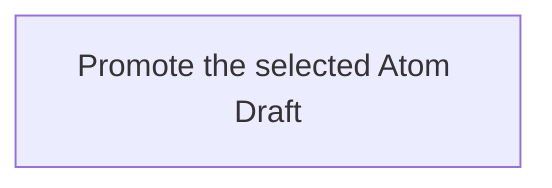

---
identity:
  atom_id: CA-O-10018
  ref_id: CA-O-10018
context:
  container:
    scope_unit: CA-SU-13
  role: Operations
  form: Workflow
  topics:
    main_subject: CAPRMEDIO_MODEL <+ Atom/(.Header.Context.Role := Operations)/Workflow/(.Purpose
      := Runtime)
    dependencies:
    - CAPRMEDIO_MODEL <+ Atom
    - CAPRMEDIO_STRUCTURE <+ Scope Unit//PROJECT_CONFIGURATION
  tier: 3
state:
  status: Active
  version: 2
  updated_at: 2026-11-11 14:19:47 +0400
destination:
  file:
    name: CA-O-10018-PROJECT_CONFIGURATION-WORKFLOW--atom-lifecycle-promote-draft.md
    path: .caprmedio_caprmedio/CA-SU-9_LAYER_1_FRAMEWORK_METHODOLOGY/CA-SU-10_SUPERLAYER_1_METHODOLOGY_SOURCES/CA-SU-13_LAYER_3_PROJECT_CONFIGURATION/09_operations
relations:
  IS_REPLACEMENT_FOR:
  - CA-O-127
---
## Summary

Atom Lifecycle_Promote Draft

## Claim scope

The invocation domain of [Promote one Atom Draft](CA-O-10005-PROJECT_CONFIGURATION-ACTION--promote-one-atom-draft.md).

## Claim

### Mermaid Scheme

### Prose Claim

This Workflow's Purpose is Runtime; its scheme follows [CA-R-1570](../../CA-SU-11_LAYER_1_CORE_META_MODEL/04_requirement/CA-R-1570-CORE_META_MODEL-RULE--keep-workflow-graphs-separate-from-step-bindings.md).

#### Input

One exact Draft selector and an allowed Current `targetStatus`; an optional `savedArchivedAtom` identifies a target already archived by a composed Update.

The `projectContext` input port binds the Project and applicable model.

#### Output

Return `savedCurrentAtom` and `removedDraft` on success, with the archived targets and completed effects. A waiting result carries `requested_input`. A failure carries the error and any completed effects. Return warnings separately.

#### Step handoffs

| Step | Receives | Produces |
| --- | --- | --- |
| [Promote the selected Atom Draft](./CA-O-10018-PROJECT_CONFIGURATION-WORKFLOW--atom-lifecycle-promote-draft/CA-O-10017-PROJECT_CONFIGURATION-STEP--promote-the-selected-atom-draft.md) | selected Draft, `targetStatus`, optional `savedArchivedAtom`, and `projectContext` | the Action result, including archived targets, completed effects or `requested_input` as applicable |

#### Logical switches

| Condition | Behavior |
| --- | --- |
| Entry | Run Promote the selected Atom Draft. |
| `savedCurrentAtom` and `removedDraft` are returned | Complete successfully. |
| A failure result is returned | Stop and report the explicit failure. |

If an Action requests additional input, return its short explanation and requested input dictionary and keep the Workflow pending. Resume with the supplied dictionary; cancellation is allowed while waiting and does not interrupt an Action.
