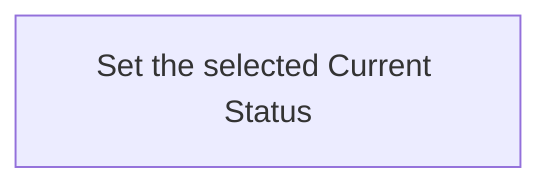

---
context:
  container:
    scope_unit: CA-SU-13
  form: Workflow
  role: Operations
  tier: 3
  topics:
    dependencies:
    - CAPRMEDIO_MODEL <+ Atom
    - CAPRMEDIO_STRUCTURE <+ Scope Unit//PROJECT_CONFIGURATION
    main_subject: CAPRMEDIO_MODEL <+ Atom/(.Header.Role := Operations)/Workflow/(.Purpose
      := Runtime)
destination:
  file:
    name: CA-O-10011@1-PROJECT_CONFIGURATION-WORKFLOW--atom-lifecycle-change-current-status.md
    path: .caprmedio_caprmedio/CA-SU-9_LAYER_1_FRAMEWORK_METHODOLOGY/CA-SU-10_SUPERLAYER_1_METHODOLOGY_SOURCES/CA-SU-13_LAYER_3_PROJECT_CONFIGURATION/09_operations/archive
identity:
  atom_id: CA-O-10011
  ref_id: CA-O-10011@1
relations:
  IS_REPLACEMENT_FOR:
  - CA-O-127
state:
  status: archived
  updated_at: 2026-11-11 14:05:36 +0400
  version: 1
---
## Summary

Atom Lifecycle_Change Current Status

## Claim scope

The invocation domain of [Set one Current Atom Status](CA-O-10007-PROJECT_CONFIGURATION-ACTION--set-one-current-atom-status.md).

## Claim

### Mermaid Scheme

### Prose Claim

This Workflow's Purpose is Runtime; its scheme follows [CA-R-1570](../../CA-SU-11_LAYER_1_CORE_META_MODEL/04_requirement/CA-R-1570-CORE_META_MODEL-RULE--keep-workflow-graphs-separate-from-step-bindings.md).

#### Input

One exact Current Atom selector and requested `targetStatus`. For a folder-backed parent, the caller first applies the containment cascade under CA-R-1521, CA-D-461 and CA-D-467 using separate one-Atom invocations. For a Plan becoming Done or Canceled, preserve recursively contained latest Plans already Done or Canceled and request Canceled for the other contained latest Plans. Stop at the first failure and report completed effects and remaining targets.

The `projectContext` input port binds the Project, applicable model, and authorization.

#### Output

The `savedCurrentAtom`, warnings, and failure result.

#### Step handoffs

| Step | Receives | Produces |
| --- | --- | --- |
| [Set the selected Current Status](./CA-O-10011-PROJECT_CONFIGURATION-WORKFLOW--atom-lifecycle-change-current-status/CA-O-10010-PROJECT_CONFIGURATION-STEP--set-the-selected-current-status.md) | selected Atom, `targetStatus`, and `projectContext` | `savedCurrentAtom`, warnings or a failure result |

#### Logical switches

| Condition | Behavior |
| --- | --- |
| Entry | Run Set the selected Current Status. |
| `savedCurrentAtom` is returned | Complete successfully. |
| A failure result is returned | Stop and report the explicit failure. |

If an Action requests additional input, return its short explanation and requested input dictionary and keep the Workflow pending. Resume with the supplied dictionary; cancellation is allowed while waiting and does not interrupt an Action.
