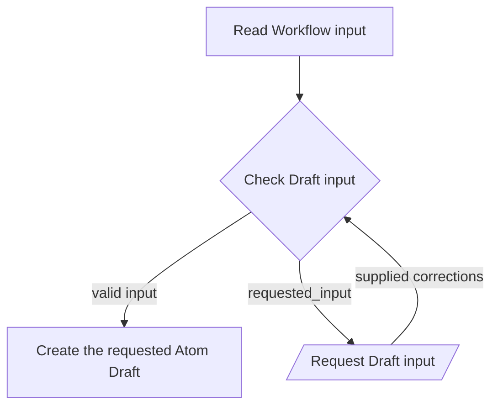

---
context:
  container:
    scope_unit: CA-SU-13
  form: Workflow
  role: Operations
  tier: 3
  topics:
    dependencies:
    - CAPRMEDIO_MODEL <+ Atom
    - CAPRMEDIO_STRUCTURE <+ Scope Unit//PROJECT_CONFIGURATION
    main_subject: CAPRMEDIO_MODEL <+ Atom/(.Header.Role := Operations)/Workflow/(.Purpose
      := Runtime)
destination:
  file:
    name: CA-O-10016@1-PROJECT_CONFIGURATION-WORKFLOW--atom-lifecycle-create-draft.md
    path: .caprmedio_caprmedio/CA-SU-9_LAYER_1_FRAMEWORK_METHODOLOGY/CA-SU-10_SUPERLAYER_1_METHODOLOGY_SOURCES/CA-SU-13_LAYER_3_PROJECT_CONFIGURATION/09_operations/archive
identity:
  atom_id: CA-O-10016
  ref_id: CA-O-10016@1
relations:
  IS_REPLACEMENT_FOR:
  - CA-O-127
state:
  status: archived
  updated_at: 2026-11-11 14:05:36 +0400
  version: 1
---
## Summary

Atom Lifecycle_Create Draft

## Claim scope

The invocation domain of [Create one Atom Draft](CA-O-10003-PROJECT_CONFIGURATION-ACTION--create-one-atom-draft.md).

## Claim

### Mermaid Scheme

### Prose Claim

This Workflow's Purpose is Runtime; its scheme follows [CA-R-1570](../../CA-SU-11_LAYER_1_CORE_META_MODEL/04_requirement/CA-R-1570-CORE_META_MODEL-RULE--keep-workflow-graphs-separate-from-step-bindings.md).

#### Input

The [Read Workflow input](./CA-O-10016-PROJECT_CONFIGURATION-WORKFLOW--atom-lifecycle-create-draft/CA-O-10014-PROJECT_CONFIGURATION-STEP--read-workflow-input.md) invocation-port contract supplies either `newAtom` properties, or an exact `sourceCurrent` selector plus requested property changes.

The `projectContext` input port binds the Project, applicable model, and authorization.

#### Output

The `savedDraft`, `requested_input`, intermediate results, warnings, and failure result.

#### Step handoffs

| Step | Receives | Produces |
| --- | --- | --- |
| [Read Workflow input](./CA-O-10016-PROJECT_CONFIGURATION-WORKFLOW--atom-lifecycle-create-draft/CA-O-10014-PROJECT_CONFIGURATION-STEP--read-workflow-input.md) | invocation dictionary and `projectContext` | accumulated `parameters` |
| [Check Draft input](./CA-O-10016-PROJECT_CONFIGURATION-WORKFLOW--atom-lifecycle-create-draft/CA-O-10012-PROJECT_CONFIGURATION-STEP--check-draft-input.md) | accumulated `parameters` and `projectContext` | logical `parameters`, `requested_input`, and warnings |
| [Request Draft input](./CA-O-10016-PROJECT_CONFIGURATION-WORKFLOW--atom-lifecycle-create-draft/CA-O-10015-PROJECT_CONFIGURATION-STEP--request-draft-input.md) | `parameters`, `requested_input`, warnings, and `projectContext` | supplied corrections, warnings and intermediate results |
| [Create the requested Atom Draft](./CA-O-10016-PROJECT_CONFIGURATION-WORKFLOW--atom-lifecycle-create-draft/CA-O-10013-PROJECT_CONFIGURATION-STEP--create-the-requested-atom-draft.md) | validated caller-bound `parameters`, warnings, `projectContext` | `savedDraft`, warnings, or a failure result |

#### Logical switches

| Condition | Behavior |
| --- | --- |
| Entry | Read Workflow input, then Check Draft input. |
| Check Draft input returns empty `requested_input` | Run Create the requested Atom Draft. |
| Check Draft input returns nonempty `requested_input` | Run Request Draft input and keep this Workflow incomplete while it waits. |
| Request Draft input supplies corrections | Check Draft input again; its Step defines the correction merge. |
| Create the requested Atom Draft returns `savedDraft` | Complete successfully. |
| A failure result is returned | Stop and report the explicit failure. |

If an Action requests additional input, return its short explanation and requested input dictionary and keep the Workflow pending. Resume with the supplied dictionary; cancellation is allowed while waiting and does not interrupt an Action.
