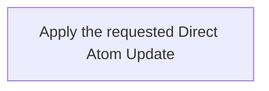

---
context:
  container:
    scope_unit: CA-SU-13
  form: Workflow
  role: Operations
  tier: 3
  topics:
    dependencies:
    - CAPRMEDIO_MODEL <+ Atom
    - CAPRMEDIO_STRUCTURE <+ Scope Unit//PROJECT_CONFIGURATION
    main_subject: CAPRMEDIO_MODEL <+ Atom/(.Header.Role := Operations)/Workflow/(.Purpose
      := Runtime)
destination:
  file:
    name: CA-O-10023@1-PROJECT_CONFIGURATION-WORKFLOW--atom-lifecycle-update-atom-directly.md
    path: .caprmedio_caprmedio/CA-SU-9_LAYER_1_FRAMEWORK_METHODOLOGY/CA-SU-10_SUPERLAYER_1_METHODOLOGY_SOURCES/CA-SU-13_LAYER_3_PROJECT_CONFIGURATION/09_operations/archive
identity:
  atom_id: CA-O-10023
  ref_id: CA-O-10023@1
relations:
  IS_REPLACEMENT_FOR:
  - CA-O-127
state:
  status: archived
  updated_at: 2026-11-11 14:05:36 +0400
  version: 1
---
## Summary

Atom Lifecycle_Update Atom Directly

## Claim scope

The invocation domain of [Apply one Direct Atom Update](CA-O-10000-PROJECT_CONFIGURATION-ACTION--apply-one-direct-atom-update.md).

## Claim

### Mermaid Scheme

### Prose Claim

This Workflow's Purpose is Runtime; its scheme follows [CA-R-1570](../../CA-SU-11_LAYER_1_CORE_META_MODEL/04_requirement/CA-R-1570-CORE_META_MODEL-RULE--keep-workflow-graphs-separate-from-step-bindings.md).

#### Input

One exact Atom selector and the requested property changes.

The `projectContext` input port binds the Project, applicable model, and authorization.

#### Output

The `savedAtom`, warnings, and failure result.

#### Step handoffs

| Step | Receives | Produces |
| --- | --- | --- |
| [Apply the requested Direct Atom Update](./CA-O-10023-PROJECT_CONFIGURATION-WORKFLOW--atom-lifecycle-update-atom-directly/CA-O-10022-PROJECT_CONFIGURATION-STEP--apply-the-requested-direct-atom-update.md) | selected Atom, requested changes, and `projectContext` | `savedAtom`, warnings or a failure result |

#### Logical switches

| Condition | Behavior |
| --- | --- |
| Entry | Run Apply the requested Direct Atom Update. |
| `savedAtom` is returned | Complete successfully. |
| A failure result is returned | Stop and report the explicit failure. |

If an Action requests additional input, return its short explanation and requested input dictionary and keep the Workflow pending. Resume with the supplied dictionary; cancellation is allowed while waiting and does not interrupt an Action.
