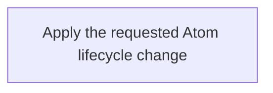

# Summary

Manage atom lifecycle

## Claim

### Mermaid Scheme

### Prose Claim

#### Inputs

The requested lifecycle operation, its one selected Atom or new Atom properties, supplied changes, applicable model and Project context. A Move binds one existing Atom, its source and destination scope; the resulting path is derived from the applicable placement rules. Scope Unit operations are outside this Workflow.

#### Step graph and bindings

This Workflow has one Step, [CA-O-129](./CA-O-129-PROJECT_CONFIGURATION-STEP--apply-an-admitted-atom-lifecycle-change.md). Entry dispatches the request and bindings to that Step, which runs CA-O-128. Its result completes the Run on success, waits for an additional input dictionary on a format or allowed-value error, or terminates with an explicit error and any completed partial effects on failure. Cancellation is allowed while waiting for input and does not interrupt an Action. There is no change-class or semantic assessment gate, reassessment, retry, rollback, recovery or repair.

#### Lifecycle behavior

Create Draft accepts new Atom properties or a selected existing Atom and merges supplied properties while retaining omissions. Derive carrier filename and path; the caller does not provide them. For a Current source whose Summary and Content Role remain unchanged, create the Draft with the same ID and Version N+1 once; editing a Draft preserves its Version and Updated At. If either Summary or Content Role changes, the result is a new identity promoted at Version 1. Promotion does not increment the Draft Version again.

Direct update edits a selected Draft, Current or Archived Atom in place without changing Version or Updated At. Archive and Status changes also preserve Version and Updated At. Update a Current Atom by creating its Draft, archiving the selected Current, then promoting the Draft with the Current Status captured from the original read. Generic Promote accepts any supplied allowed Current Status.

For promotion, resolve every distinct `IS_REPLACEMENT_FOR` target, including different IDs and many-to-one replacements. Before publishing the Current successor, archive each eligible Current target once and skip every target already Archived, including one archived by the composed Update. Then publish the Draft and remove its Draft carrier. A failure stops the operation and reports actual partial effects.

Move binds one existing Atom and its source and destination, preserves its identity and content meaning, and derives the resulting carrier path under applicable placement rules. It does not discover or move other independent Atoms or perform Scope Unit operations.

When a Status change requires a containment cascade, the caller composes separate one-Atom invocations under Current CA-R-1521 and placement decisions CA-D-461 and CA-D-467. For Archive this includes all recursively contained latest Atoms. For a Plan becoming Done or Canceled, retain contained latest Plans already Done or Canceled and request Canceled for the other contained latest Plans. The caller handles descendants before parent relocation, stops at the first error, and reports completed effects and remaining targets without rollback or retry. Each invocation reports only its own result.

Journal observations describe actual business events; recording failure is nonblocking. This source definition does not establish runtime execution. Separate lifecycle Workflows remain Draft pending an adoption decision.
