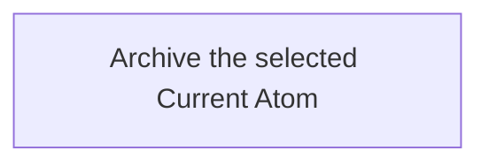

## Summary

Atom Lifecycle_Archive Atom

## Claim scope

This Workflow targets one explicitly selected non-container Current Atom. Archived, container, inferred, descendant, and collection inputs are explicit errors.

## Claim

This Workflow's Purpose is Runtime. Step order follows [CA-R-1570](../../../../CA-SU-11_LAYER_1_CORE_META_MODEL/04_requirement/CA-R-1570-CORE_META_MODEL-RULE--keep-workflow-graphs-separate-from-step-bindings.md).

### Input

One exact Current Atom selector.

The Project, applicable model, authorization and required destinations are bound from the request and Project configuration. They are execution context, not additional proof or receipt inputs.

### Output

The saved Archived Atom with its version-qualified marker and location. Numeric Version and Updated At are preserved.

On failure, return the explicit error and actual completed results under [CA-R-1432](../../../../CA-SU-11_LAYER_1_CORE_META_MODEL/04_requirement/draft/lifecycle-in-place-edits/CA-R-1432@28-draft-CORE_META_MODEL-RULE--classify-admitted-atom-changes-by-semantic-effect.md). A partially completed operation does not report uncompleted effects as successful.

### Step handoffs

| Step | Receives | Produces | Next |
| --- | --- | --- | --- |
| [Archive the selected Current Atom](./CA-O-draft-PROJECT_CONFIGURATION-WORKFLOW--atom-lifecycle-archive-atom/CA-O-draft-PROJECT_CONFIGURATION-STEP--archive-the-selected-current-atom.md) | Selected Current Atom and execution context | Saved Archived Atom | Return the Archived Atom |

### Logical switches

This Workflow has one Step and no alternate Step route. These cases are selected or rejected inside its Action; they do not add Workflow Steps.

| Condition | Behavior |
| --- | --- |
| Selected Atom is an admitted non-container Current Atom | The Action archives it. |
| Selected Atom is outside that scope, including already Archived | The Action returns an explicit error. There is no alternate or no-op route. |
