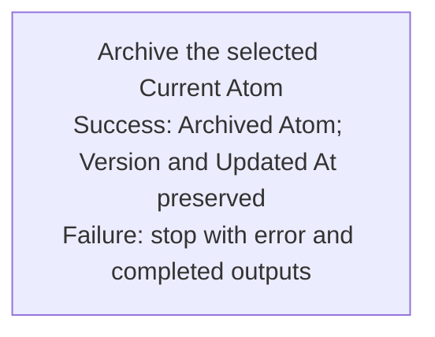

## Summary

Atom Lifecycle_Archive Atom

## Claim scope

This Workflow targets one explicitly selected non-container Current Atom. Archived, container, inferred, descendant, and collection inputs are explicit errors.

## Claim

This Workflow's Purpose is Runtime.

The caller supplies the exact Current source, applicable model, destination, and authorization.

Invoke [Archive the selected Current Atom](CA-O-draft-PROJECT_CONFIGURATION-WORKFLOW--atom-lifecycle-archive-atom/CA-O-draft-PROJECT_CONFIGURATION-STEP--archive-the-selected-current-atom.md) once under the [Workflow graph rule](../../../../CA-SU-11_LAYER_1_CORE_META_MODEL/04_requirement/CA-R-1570-CORE_META_MODEL-RULE--keep-workflow-graphs-separate-from-step-bindings.md). Return its result or its explicit error with completed outputs under [CA-R-1432@28-draft](../../../../CA-SU-11_LAYER_1_CORE_META_MODEL/04_requirement/draft/lifecycle-in-place-edits/CA-R-1432@28-draft-CORE_META_MODEL-RULE--classify-admitted-atom-changes-by-semantic-effect.md).
