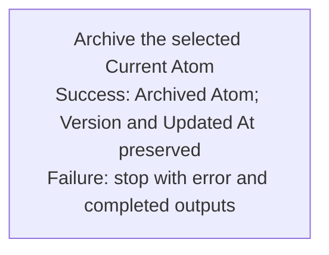

## Summary

Atom Lifecycle_Archive Atom

## Claim scope

This Workflow targets one explicitly selected non-container Current Atom. Archived, container, inferred, descendant, and collection inputs are explicit errors.

## Claim

This Workflow's Purpose is Runtime.

**Preconditions:** The caller supplies the exact Current source/version, model and Scope Unit, destination, authorization, and optional known `targetID` context. The Action owns schema, mandatory-field, status, currentness, placement, permission, collision, and no-overwrite validation. A supplied `targetID` is only a business observation. Missing, ambiguous, stale, unsupported, Archived, container, or conflicting input returns an explicit error before writing.

**Intended effect:** Invoke [Archive the selected Current Atom](CA-O-draft-PROJECT_CONFIGURATION-WORKFLOW--atom-lifecycle-archive-atom/CA-O-draft-PROJECT_CONFIGURATION-STEP--archive-the-selected-current-atom.md) exactly once under the [Workflow graph rule](../../../../CA-SU-11_LAYER_1_CORE_META_MODEL/04_requirement/CA-R-1570-CORE_META_MODEL-RULE--keep-workflow-graphs-separate-from-step-bindings.md).

**Returned evidence:** After save/readback, return `archived` with `ID@N` Archived, unchanged Version, Updated At, content, and synchronized location; include `targetID` only as business observation. On failure, stop with actual completed outputs and an explicit error; do not retry, replay, repair, or perform a rollback. Create no successor, promotion, reference retarget, deletion/reactivation, or descendant cascade. Journal append is independent and nonblocking.
