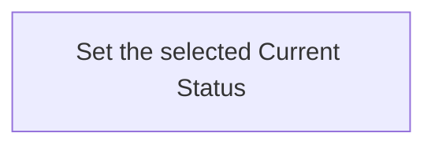

## Summary

Atom Lifecycle_Change Current Status

## Claim scope

One exact non-container Current Atom and one requested Status in its model's Current group.

## Claim

This Workflow's Purpose is Runtime. Step order follows [CA-R-1570](../../../../CA-SU-11_LAYER_1_CORE_META_MODEL/04_requirement/CA-R-1570-CORE_META_MODEL-RULE--keep-workflow-graphs-separate-from-step-bindings.md).

### Input

One exact Current Atom selector and the requested `targetStatus` within the applicable Current group.

The Project, applicable model, authorization and required destinations are bound from the request and Project configuration. They are execution context, not additional proof or receipt inputs.

### Output

The saved Current Atom carrying the requested Status and synchronized location. Identity, content, Version and Updated At are unchanged.

On failure, return the explicit error and actual completed results under [CA-R-1432](../../../../CA-SU-11_LAYER_1_CORE_META_MODEL/04_requirement/draft/lifecycle-in-place-edits/CA-R-1432@28-draft-CORE_META_MODEL-RULE--classify-admitted-atom-changes-by-semantic-effect.md). A partially completed operation does not report uncompleted effects as successful.

### Step handoffs

| Step | Receives | Produces | Next |
| --- | --- | --- | --- |
| [Set the selected Current Status](./CA-O-draft-PROJECT_CONFIGURATION-WORKFLOW--atom-lifecycle-change-current-status/CA-O-draft-PROJECT_CONFIGURATION-STEP--set-the-selected-current-status.md) | Selected Current Atom, targetStatus and execution context | Saved Current Atom | Return the Atom |

### Logical switches

This Workflow has one Step and no alternate Step route. These cases are selected or rejected inside its Action; they do not add Workflow Steps.

| Condition | Behavior |
| --- | --- |
| Requested Status belongs to the applicable Current group | The Action changes Status in place. |
| Requested Status is outside that group, including Draft or Archived | The Action returns an explicit error; it does not route to another Workflow. |
