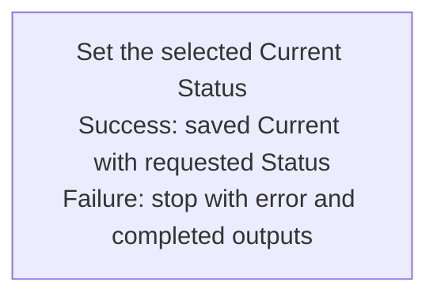

## Summary

Atom Lifecycle_Change Current Status

## Claim scope

One exact non-container Current Atom and one requested Status in its model's Current group.

## Claim

This Workflow's Purpose is Runtime.

Run [Set the selected Current Atom Status](CA-O-draft-PROJECT_CONFIGURATION-WORKFLOW--atom-lifecycle-change-current-status/CA-O-draft-PROJECT_CONFIGURATION-STEP--set-the-selected-current-status.md) once for the selected Atom and Status.

Return the saved carrier. The Action changes only Status and synchronizes filename/location. On failure, return the error with completed outputs under [CA-R-1432](../../../../CA-SU-11_LAYER_1_CORE_META_MODEL/04_requirement/draft/lifecycle-in-place-edits/CA-R-1432@28-draft-CORE_META_MODEL-RULE--classify-admitted-atom-changes-by-semantic-effect.md).
