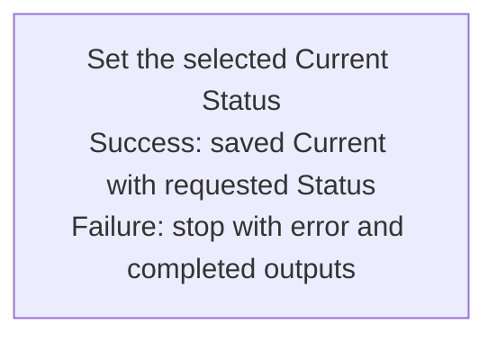

## Summary

Atom Lifecycle_Change Current Status

## Claim scope

This Workflow coordinates one exact non-container Current Atom under its applicable model and one requested Status admitted to that model's Current group. The Current group includes model-admitted statuses beyond Active when present and excludes Draft and Archived. It rejects containers, semantically contained Atoms, descendant selection and cascade; it does not change scope or tier.

## Claim

This Workflow's Purpose is Runtime.

Run [Set the selected Current Atom Status](CA-O-draft-PROJECT_CONFIGURATION-WORKFLOW--atom-lifecycle-change-current-status/CA-O-draft-PROJECT_CONFIGURATION-STEP--set-the-selected-current-status.md) once for one exact non-container Current Atom and one Status admitted by its qualified model's Current group. Draft and Archived are excluded; Active is never assumed.

Return the saved carrier after changing only Status and synchronizing its filename/location. Preserve identity, Summary, Role, content, Version, and Updated At; create no archive, successor, or promotion. Invalid, stale, ambiguous, colliding, or failed input returns actual outputs and an error. Exclude containers, descendants, and cascades; do not retry, replay, or roll back. The graph follows [CA-R-1570](../../../../CA-SU-11_LAYER_1_CORE_META_MODEL/04_requirement/CA-R-1570-CORE_META_MODEL-RULE--keep-workflow-graphs-separate-from-step-bindings.md); Journal records business events only and is nonblocking.
