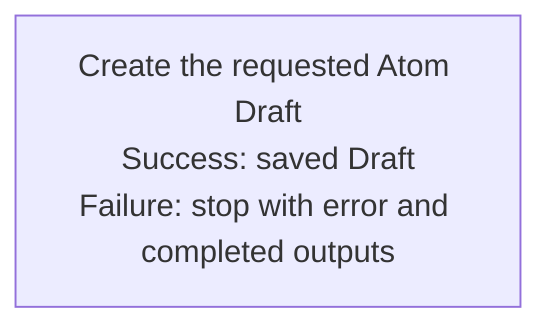

## Summary

Atom Lifecycle_Create Draft

## Claim scope

One non-container Draft request under its applicable model: a new Atom or a new Version from one exact Current selector.

## Claim

This Workflow's Purpose is Runtime and it owns the one-step graph under [CA-R-1570](../../../../CA-SU-11_LAYER_1_CORE_META_MODEL/04_requirement/CA-R-1570-CORE_META_MODEL-RULE--keep-workflow-graphs-separate-from-step-bindings.md). It accepts either `newAtom` properties or one exact `sourceCurrent` selector with changed properties, plus Draft destination, model and permissions, then runs [Create the requested Atom Draft](./CA-O-draft-PROJECT_CONFIGURATION-WORKFLOW--atom-lifecycle-create-draft/CA-O-draft-PROJECT_CONFIGURATION-STEP--create-the-requested-atom-draft.md) once. The Step binds parameters; the Action owns merge, lifecycle, validation and saved-carrier verification.

Return the Action's result. Failures follow [CA-R-1432](../../../../CA-SU-11_LAYER_1_CORE_META_MODEL/04_requirement/draft/lifecycle-in-place-edits/CA-R-1432@28-draft-CORE_META_MODEL-RULE--classify-admitted-atom-changes-by-semantic-effect.md).

