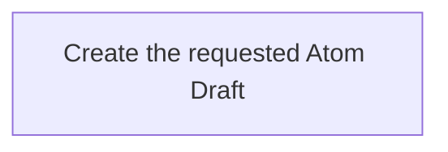

## Summary

Atom Lifecycle_Create Draft

## Claim scope

One non-container Draft request under its applicable model: a new Atom or a new Version from one exact Current selector.

## Claim

This Workflow's Purpose is Runtime. Step order follows [CA-R-1570](../../../../CA-SU-11_LAYER_1_CORE_META_MODEL/04_requirement/CA-R-1570-CORE_META_MODEL-RULE--keep-workflow-graphs-separate-from-step-bindings.md).

### Input

Either `newAtom` properties, or an exact `sourceCurrent` selector plus the requested property changes.

The Project, applicable model, authorization and required destinations are bound from the request and Project configuration. They are execution context, not additional proof or receipt inputs.

### Output

The saved Draft, including its carried marker, Version and location. No canonical ID is allocated for a role-only Draft.

On failure, return the explicit error and actual completed results under [CA-R-1432](../../../../CA-SU-11_LAYER_1_CORE_META_MODEL/04_requirement/draft/lifecycle-in-place-edits/CA-R-1432@28-draft-CORE_META_MODEL-RULE--classify-admitted-atom-changes-by-semantic-effect.md). A partially completed operation does not report uncompleted effects as successful.

### Step handoffs

| Step | Receives | Produces | Next |
| --- | --- | --- | --- |
| [Create the requested Atom Draft](./CA-O-draft-PROJECT_CONFIGURATION-WORKFLOW--atom-lifecycle-create-draft/CA-O-draft-PROJECT_CONFIGURATION-STEP--create-the-requested-atom-draft.md) | The selected input form and execution context | Saved Draft | Return the Draft |

### Logical switches

This Workflow has one Step and no alternate Step route. These cases are selected or rejected inside its Action; they do not add Workflow Steps.

| Condition | Behavior |
| --- | --- |
| Current source supplied | The Action reads all Current properties and applies only the supplied changes; omitted properties are retained. |
| New Atom requested | The Action uses the supplied new-Atom properties. |
| Merged Summary and Role match the Current | The Action creates an existing-Atom Draft marker proposing Version N+1. |
| New Atom, or changed Summary/Role | The Action creates a role-only Draft; its fresh canonical ID is allocated during Promote. |
