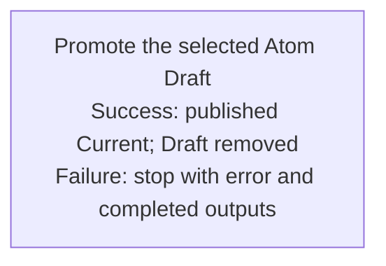

## Summary

Atom Lifecycle_Promote Draft

## Claim scope

This Workflow handles one exact selected Draft for one non-container Atom under the applicable model. It rejects semantic containers and does not select descendants or perform a cascade.

## Claim

This Workflow's Purpose is Runtime.

The caller supplies the selected Draft, applicable model, destination, and an explicit model-admitted Current Status. In [Atom Lifecycle_Update Atom](./CA-O-draft-PROJECT_CONFIGURATION-WORKFLOW--atom-lifecycle-update-atom.md), pass the original Current Status captured before archival.

Invoke [Promote the selected Atom Draft](CA-O-draft-PROJECT_CONFIGURATION-WORKFLOW--atom-lifecycle-promote-draft/CA-O-draft-PROJECT_CONFIGURATION-STEP--promote-the-selected-atom-draft.md) once under the [Workflow graph rule](../../../../CA-SU-11_LAYER_1_CORE_META_MODEL/04_requirement/CA-R-1570-CORE_META_MODEL-RULE--keep-workflow-graphs-separate-from-step-bindings.md). Return its result or its explicit error with completed outputs under [CA-R-1432@28-draft](../../../../CA-SU-11_LAYER_1_CORE_META_MODEL/04_requirement/draft/lifecycle-in-place-edits/CA-R-1432@28-draft-CORE_META_MODEL-RULE--classify-admitted-atom-changes-by-semantic-effect.md).

