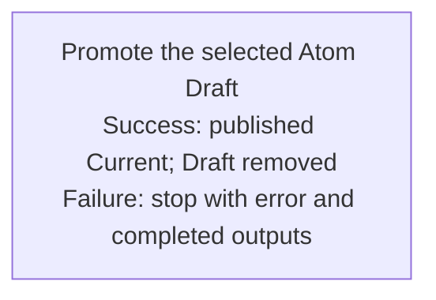

## Summary

Atom Lifecycle_Promote Draft

## Claim scope

This Workflow handles one exact selected Draft for one non-container Atom under the applicable model. It rejects semantic containers and does not select descendants or perform a cascade.

## Claim

This Workflow's Purpose is Runtime.

**Preconditions:** The caller supplies the exact Draft, applicable model and destination, an explicit model-admitted Current Status, and a resolved `targetID`/`targetVersion`; the Action reads the selected Draft for its content and mandatory fields. A standalone caller resolves that target context before the Step. Within [Atom Lifecycle_Update Atom](./CA-O-draft-PROJECT_CONFIGURATION-WORKFLOW--atom-lifecycle-update-atom.md), bind the prepared identity/version and the original Current Status captured before archival; an archive receipt is not a publication gate and this Workflow does not archive implicitly. Pass the Status unchanged; never default to `Active` or infer/reuse history.

**Intended effect:** Invoke [Promote the selected Atom Draft](CA-O-draft-PROJECT_CONFIGURATION-WORKFLOW--atom-lifecycle-promote-draft/CA-O-draft-PROJECT_CONFIGURATION-STEP--promote-the-selected-atom-draft.md) exactly once under the [Workflow graph rule](../../../../CA-SU-11_LAYER_1_CORE_META_MODEL/04_requirement/CA-R-1570-CORE_META_MODEL-RULE--keep-workflow-graphs-separate-from-step-bindings.md).

**Returned evidence:** Return the saved Current and removed Draft only after readback verifies the publication. Existing-Atom identity uses its exact intended Version, normally N+1; new-Atom or Summary/Role replacement uses the selected ID at canonical Version 1 even when Draft Version is greater than 1. Invalid, stale, ambiguous, colliding, or failed writes stop with actual completed outputs and an explicit error. The Workflow has one Step; the Step owns bindings and the Action owns validation/effects. Do not retry, replay, repair, or perform a rollback. Journal business-event append is independent and nonblocking.

