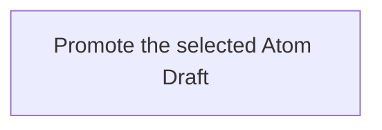

## Summary

Atom Lifecycle_Promote Draft

## Claim scope

This Workflow handles one exact selected Draft for one non-container Atom under the applicable model. It rejects semantic containers and does not select descendants or perform a cascade.

## Claim

This Workflow's Purpose is Runtime. Step order follows [CA-R-1570](../../../../CA-SU-11_LAYER_1_CORE_META_MODEL/04_requirement/CA-R-1570-CORE_META_MODEL-RULE--keep-workflow-graphs-separate-from-step-bindings.md).

### Input

One exact Draft selector and an explicit `targetStatus` admitted by the model's Current group. In composed Update, use the original Current Status captured before archival.

The Project, applicable model, authorization and required destinations are bound from the request and Project configuration. They are execution context, not additional proof or receipt inputs.

### Output

The saved Current Atom with its actual canonical ID, published Version, Status and location; the selected Draft has been removed.

On failure, return the explicit error and actual completed results under [CA-R-1432](../../../../CA-SU-11_LAYER_1_CORE_META_MODEL/04_requirement/draft/lifecycle-in-place-edits/CA-R-1432@28-draft-CORE_META_MODEL-RULE--classify-admitted-atom-changes-by-semantic-effect.md). A partially completed operation does not report uncompleted effects as successful.

### Step handoffs

| Step | Receives | Produces | Next |
| --- | --- | --- | --- |
| [Promote the selected Atom Draft](./CA-O-draft-PROJECT_CONFIGURATION-WORKFLOW--atom-lifecycle-promote-draft/CA-O-draft-PROJECT_CONFIGURATION-STEP--promote-the-selected-atom-draft.md) | Selected Draft, targetStatus and execution context | Published Current Atom and completed Draft removal | Return the publication |

### Logical switches

This Workflow has one Step and no alternate Step route. These cases are selected or rejected inside its Action; they do not add Workflow Steps.

| Condition | Behavior |
| --- | --- |
| Draft marker identifies an existing Atom and proposed Version | The Action publishes that canonical ID at its proposed Version. |
| Draft has a role-only marker | The Action allocates a fresh canonical ID and publishes Version 1. |
| Requested Status is not in the applicable Current group | The Action returns an explicit error; no Active default is substituted. |
