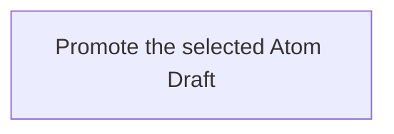

## Summary

Atom Lifecycle_Promote Draft

## Claim scope

The invocation domain of [Promote one Atom Draft](CA-O-draft-PROJECT_CONFIGURATION-ACTION--promote-one-atom-draft.md).

## Claim

### Mermaid Scheme

This Workflow's Purpose is Runtime; its scheme follows [CA-R-1570](../../../../CA-SU-11_LAYER_1_CORE_META_MODEL/04_requirement/CA-R-1570-CORE_META_MODEL-RULE--keep-workflow-graphs-separate-from-step-bindings.md).

### Input

One exact Draft selector and `targetStatus`.

The `projectContext` input port binds the Project, applicable model, and authorization.

### Output

The `savedCurrentAtom`, `removedDraft`, warnings, and failure result.

### Step handoffs

| Step | Receives | Produces |
| --- | --- | --- |
| [Promote the selected Atom Draft](./CA-O-draft-PROJECT_CONFIGURATION-WORKFLOW--atom-lifecycle-promote-draft/CA-O-draft-PROJECT_CONFIGURATION-STEP--promote-the-selected-atom-draft.md) | selected Draft, `targetStatus`, and `projectContext` | `savedCurrentAtom`, `removedDraft`, warnings or a failure result |

### Logical switches

| Condition | Behavior |
| --- | --- |
| Entry | Run Promote the selected Atom Draft. |
| `savedCurrentAtom` and `removedDraft` are returned | Complete successfully. |
| A failure result is returned | Terminate under [CA-R-1432](../../../../CA-SU-11_LAYER_1_CORE_META_MODEL/04_requirement/draft/lifecycle-in-place-edits/CA-R-1432@28-draft-CORE_META_MODEL-RULE--classify-admitted-atom-changes-by-semantic-effect.md). |
