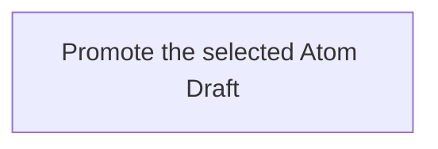

## Summary

Atom Lifecycle_Promote Draft

## Claim scope

The invocation domain of [Promote one Atom Draft](CA-O-draft-PROJECT_CONFIGURATION-ACTION--promote-one-atom-draft.md).

## Claim

### Mermaid Scheme

### Prose Claim

This Workflow's Purpose is Runtime; its scheme follows [CA-R-1570](../../../../CA-SU-11_LAYER_1_CORE_META_MODEL/04_requirement/CA-R-1570-CORE_META_MODEL-RULE--keep-workflow-graphs-separate-from-step-bindings.md).

#### Input

One exact Draft selector and an allowed Current `targetStatus`; an optional `savedArchivedAtom` identifies a target already archived by a composed Update.

The `projectContext` input port binds the Project, applicable model, and authorization.

#### Output

The `savedCurrentAtom`, `removedDraft`, warnings, and failure result.

#### Step handoffs

| Step | Receives | Produces |
| --- | --- | --- |
| [Promote the selected Atom Draft](./CA-O-draft-PROJECT_CONFIGURATION-WORKFLOW--atom-lifecycle-promote-draft/CA-O-draft-PROJECT_CONFIGURATION-STEP--promote-the-selected-atom-draft.md) | selected Draft, `targetStatus`, optional `savedArchivedAtom`, and `projectContext` | `savedCurrentAtom`, `removedDraft`, warnings or a failure result |

#### Logical switches

| Condition | Behavior |
| --- | --- |
| Entry | Run Promote the selected Atom Draft. |
| `savedCurrentAtom` and `removedDraft` are returned | Complete successfully. |
| A failure result is returned | Stop and report the explicit failure. |

If an Action requests additional input, return its short explanation and requested input dictionary and keep the Workflow pending. Resume with the supplied dictionary; cancellation is allowed while waiting and does not interrupt an Action.
