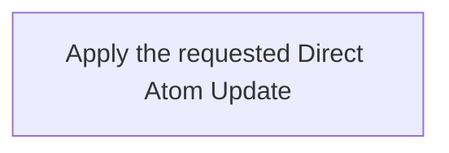

## Summary

Atom Lifecycle_Update Atom Directly

## Claim scope

One exactly selected non-container Atom: a Draft for semantic in-place editing, or a Current/Archived carrier for technical in-place editing.

## Claim

This Workflow's Purpose is Runtime. Step order follows [CA-R-1570](../../../../CA-SU-11_LAYER_1_CORE_META_MODEL/04_requirement/CA-R-1570-CORE_META_MODEL-RULE--keep-workflow-graphs-separate-from-step-bindings.md).

### Input

One exact Atom selector and the requested property changes.

The Project, applicable model, authorization and required destinations are bound from the request and Project configuration. They are execution context, not additional proof or receipt inputs.

### Output

The saved Atom after the in-place edit. Version and Updated At are unchanged.

On failure, return the explicit error and actual completed results under [CA-R-1432](../../../../CA-SU-11_LAYER_1_CORE_META_MODEL/04_requirement/draft/lifecycle-in-place-edits/CA-R-1432@28-draft-CORE_META_MODEL-RULE--classify-admitted-atom-changes-by-semantic-effect.md). A partially completed operation does not report uncompleted effects as successful.

### Step handoffs

| Step | Receives | Produces | Next |
| --- | --- | --- | --- |
| [Apply the requested Direct Atom Update](./CA-O-draft-PROJECT_CONFIGURATION-WORKFLOW--atom-lifecycle-update-atom-directly/CA-O-draft-PROJECT_CONFIGURATION-STEP--apply-the-requested-direct-atom-update.md) | Selected Atom, requested changes and execution context | Saved Atom | Return the Atom |

### Logical switches

This Workflow has one Step and no alternate Step route. These cases are selected or rejected inside its Action; they do not add Workflow Steps.

| Condition | Behavior |
| --- | --- |
| Selected Atom is Draft | The Action edits it in place. A Summary/Role change switches its marker to a role-only Draft. |
| Selected Atom is Current or Archived | The Action permits technical edits only; semantic changes return an explicit error. |
| Status is outside the supported groups | The Action returns an explicit error. |
