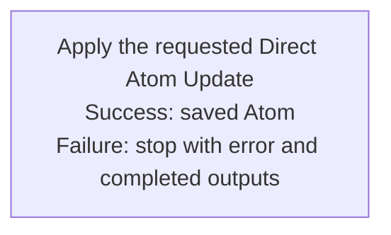

## Summary

Atom Lifecycle_Update Atom Directly

## Claim scope

One exactly selected non-container Atom: a Draft for semantic in-place editing, or a Current/Archived carrier for technical in-place editing.

## Claim

This Workflow's Purpose is Runtime.

Accept one exact target and requested changes, derive the Draft, Current, or Archived case from Status and its model, then run [Apply the requested Direct Atom Update](CA-O-draft-PROJECT_CONFIGURATION-WORKFLOW--atom-lifecycle-update-atom-directly/CA-O-draft-PROJECT_CONFIGURATION-STEP--apply-the-requested-direct-atom-update.md) once. Return the saved result or an explicit error with completed partial outputs. A semantic Current request is an explicit error; the caller may separately select [Atom Lifecycle_Update Atom](./CA-O-draft-PROJECT_CONFIGURATION-WORKFLOW--atom-lifecycle-update-atom.md). Invalid, ambiguous, stale, or conflicting input stops without writing.

Draft content is edited in place with Version and Updated At preserved and Current untouched. A Summary/Role change updates the role-only intent marker and filename while retaining Draft metadata; promotion publishes the canonical Atom at Version 1. Current and Archived edits are technical-only, in place, preserve Version and Updated At, and synchronize filename/location. Current creates no archive or successor; Archived cannot publish Current or promote a Draft.

This Workflow owns one Step, the Step owns bindings, and the Action owns effects under [CA-R-1570](../../../../CA-SU-11_LAYER_1_CORE_META_MODEL/04_requirement/CA-R-1570-CORE_META_MODEL-RULE--keep-workflow-graphs-separate-from-step-bindings.md), [CA-R-2639](../../../../CA-SU-11_LAYER_1_CORE_META_MODEL/04_requirement/CA-R-2639-CORE_META_MODEL-RULE--bind-step-parameters.md), and [CA-R-2638](../../../../CA-SU-11_LAYER_1_CORE_META_MODEL/04_requirement/CA-R-2638-CORE_META_MODEL-DECLARATION--define-runs.md). Containers, descendants, and cascades are excluded. A failed mutation returns completed outputs and an error; do not retry, replay, or roll back. Journal records business events only and is nonblocking.
