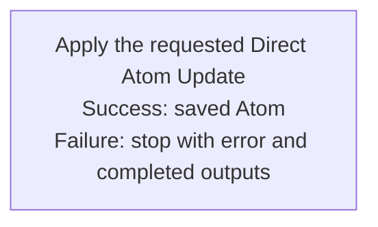

## Summary

Atom Lifecycle_Update Atom Directly

## Claim scope

One exactly selected non-container Atom: a Draft for semantic in-place editing, or a Current/Archived carrier for technical in-place editing.

## Claim

This Workflow's Purpose is Runtime. It accepts one exact target and requested changes, then runs [Apply the requested Direct Atom Update](CA-O-draft-PROJECT_CONFIGURATION-WORKFLOW--atom-lifecycle-update-atom-directly/CA-O-draft-PROJECT_CONFIGURATION-STEP--apply-the-requested-direct-atom-update.md) once.

The Workflow owns one Step under [CA-R-1570](../../../../CA-SU-11_LAYER_1_CORE_META_MODEL/04_requirement/CA-R-1570-CORE_META_MODEL-RULE--keep-workflow-graphs-separate-from-step-bindings.md); the Step owns bindings under [CA-R-2639](../../../../CA-SU-11_LAYER_1_CORE_META_MODEL/04_requirement/CA-R-2639-CORE_META_MODEL-RULE--bind-step-parameters.md); the Action owns the effect under [CA-R-2638](../../../../CA-SU-11_LAYER_1_CORE_META_MODEL/04_requirement/CA-R-2638-CORE_META_MODEL-DECLARATION--define-runs.md). Return the Action's result. Failures follow [CA-R-1432](../../../../CA-SU-11_LAYER_1_CORE_META_MODEL/04_requirement/draft/lifecycle-in-place-edits/CA-R-1432@28-draft-CORE_META_MODEL-RULE--classify-admitted-atom-changes-by-semantic-effect.md).
