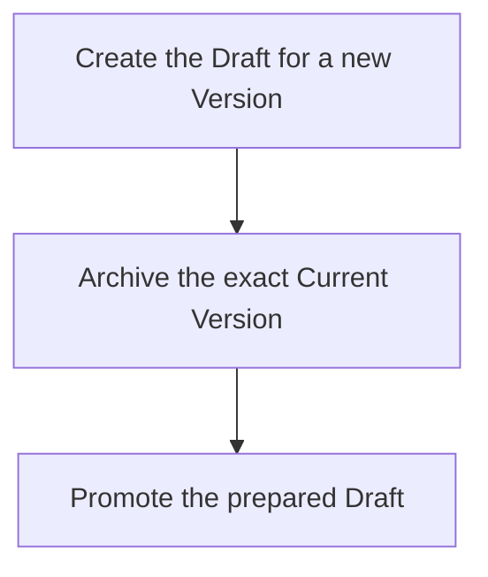

## Summary

Atom Lifecycle_Update Atom

## Claim scope

One non-container Current-backed proposal under the applicable model in PROJECT_CONFIGURATION.

## Claim

This Workflow's Purpose is Runtime. Step order follows [CA-R-1570](../../../../CA-SU-11_LAYER_1_CORE_META_MODEL/04_requirement/CA-R-1570-CORE_META_MODEL-RULE--keep-workflow-graphs-separate-from-step-bindings.md).

### Input

One exact `sourceCurrent` selector and the requested property changes. Before Step 1, retain the source's Status as `targetStatus` in Workflow context.

The Project, applicable model, authorization and required destinations are bound from the request and Project configuration. They are execution context, not additional proof or receipt inputs.

### Output

The published Current Atom with the original Current Status. The predecessor was archived and the prepared Draft was removed. Summary/Role replacement may produce a different canonical ID.

On failure, return the explicit error and actual completed results under [CA-R-1432](../../../../CA-SU-11_LAYER_1_CORE_META_MODEL/04_requirement/draft/lifecycle-in-place-edits/CA-R-1432@28-draft-CORE_META_MODEL-RULE--classify-admitted-atom-changes-by-semantic-effect.md). A partially completed operation does not report uncompleted effects as successful.

### Step handoffs

| Step | Receives | Produces | Next |
| --- | --- | --- | --- |
| [Create the Draft for a new Version](./CA-O-draft-PROJECT_CONFIGURATION-WORKFLOW--atom-lifecycle-update-atom/CA-O-draft-PROJECT_CONFIGURATION-STEP--create-the-draft-for-a-new-version.md) | sourceCurrent, requested changes and execution context | Saved Draft | Retain the Draft in Workflow context; run Step 2 |
| [Archive the exact Current Version](./CA-O-draft-PROJECT_CONFIGURATION-WORKFLOW--atom-lifecycle-update-atom/CA-O-draft-PROJECT_CONFIGURATION-STEP--archive-the-exact-current-version.md) | The original sourceCurrent and execution context, not the saved Draft | Saved Archived predecessor | Retain this result; run Step 3 |
| [Promote the prepared Draft](./CA-O-draft-PROJECT_CONFIGURATION-WORKFLOW--atom-lifecycle-update-atom/CA-O-draft-PROJECT_CONFIGURATION-STEP--promote-the-prepared-draft.md) | The saved Draft from Step 1, captured targetStatus and execution context | Published Current Atom and completed Draft removal | Return the publication |

### Logical switches

Workflow routing is strictly Step 1 -> Step 2 -> Step 3 on success. Identity and marker decisions stay inside the called Actions. The saved Draft and captured Status stay in Workflow context across Archive; they are not Archive inputs.

| Condition | Behavior |
| --- | --- |
| Step succeeds | Run the next numbered Step, or return the final result after Step 3. |
| Step fails | Stop; return the explicit error and actual completed results. Do not run the next Step. |

## Details

Version means the Atom's numeric `Header.Version`. N is the source Current Version. A same-identity Draft proposes N+1; publishing a fresh canonical Atom starts at 1. Draft edits, archival and Current-status changes do not increment Version.
