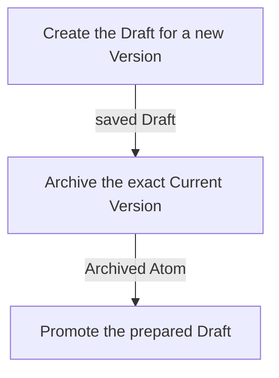

## Summary

Atom Lifecycle_Update Atom

## Claim scope

Composed lifecycle update in PROJECT_CONFIGURATION.

## Claim

### Mermaid Scheme

This Workflow's Purpose is Runtime; its scheme follows [CA-R-1570](../../../../CA-SU-11_LAYER_1_CORE_META_MODEL/04_requirement/CA-R-1570-CORE_META_MODEL-RULE--keep-workflow-graphs-separate-from-step-bindings.md).

### Input

One exact `sourceCurrent` selector and requested property changes. Before Step 1, read the selected source once; bind that read as internal `expectedSource` under [CA-R-1432](../../../../CA-SU-11_LAYER_1_CORE_META_MODEL/04_requirement/draft/lifecycle-in-place-edits/CA-R-1432@28-draft-CORE_META_MODEL-RULE--classify-admitted-atom-changes-by-semantic-effect.md), and bind its Status from the same read as internal `targetStatus`.

The `projectContext` input port binds the Project, applicable model, and authorization.

### Output

The `savedCurrentAtom`, `savedArchivedAtom`, `removedDraft`, `requested_input`, intermediate results, warnings, and failure result.

### Step handoffs

| Step | Receives | Produces |
| --- | --- | --- |
| [Create the Draft for a new Version](./CA-O-draft-PROJECT_CONFIGURATION-WORKFLOW--atom-lifecycle-update-atom/CA-O-draft-PROJECT_CONFIGURATION-STEP--create-the-draft-for-a-new-version.md) | `sourceCurrent`, requested changes, internal `expectedSource`, and `projectContext` | `savedDraft`, `requested_input`, warnings, intermediate results, or a failure result |
| [Archive the exact Current Version](./CA-O-draft-PROJECT_CONFIGURATION-WORKFLOW--atom-lifecycle-update-atom/CA-O-draft-PROJECT_CONFIGURATION-STEP--archive-the-exact-current-version.md) | original `sourceCurrent`, internal `expectedSource`, warnings, and `projectContext` | `savedArchivedAtom`, warnings, or a failure result |
| [Promote the prepared Draft](./CA-O-draft-PROJECT_CONFIGURATION-WORKFLOW--atom-lifecycle-update-atom/CA-O-draft-PROJECT_CONFIGURATION-STEP--promote-the-prepared-draft.md) | `savedDraft`, captured `targetStatus`, warnings, and `projectContext` | `savedCurrentAtom`, `removedDraft`, warnings, or a failure result |

### Logical switches

| Condition | Behavior |
| --- | --- |
| Entry | Run Create the Draft for a new Version. |
| Step 1 returns nonempty `requested_input` | Keep this Workflow pending; corrections resume Step 1 with captured `expectedSource` and `targetStatus` preserved. |
| Step 1 returns `savedDraft` | Run Archive the exact Current Version. |
| Step 2 returns `savedArchivedAtom` | Run Promote the prepared Draft. |
| Step 3 returns `savedCurrentAtom` and `removedDraft` | Complete successfully. |
| A failure result is returned | Terminate under [CA-R-1432](../../../../CA-SU-11_LAYER_1_CORE_META_MODEL/04_requirement/draft/lifecycle-in-place-edits/CA-R-1432@28-draft-CORE_META_MODEL-RULE--classify-admitted-atom-changes-by-semantic-effect.md). |
