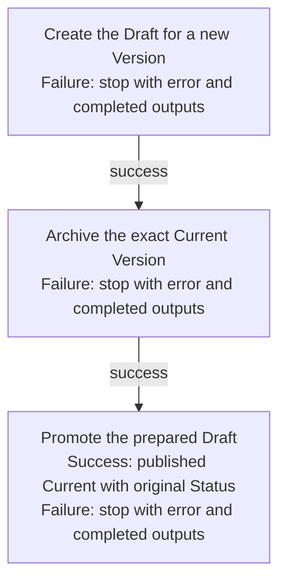

## Summary

Atom Lifecycle_Update Atom

## Claim scope

One non-container Current-backed proposal under the applicable model in PROJECT_CONFIGURATION.

## Claim

This Workflow's Purpose is Runtime.

Inputs are one exact `sourceCurrent` selector with the requested property changes, applicable model, ordinary authorization, and placement. Before any effect, capture the source Current's exact Status as `targetStatus` and validate that Status against the proposed Atom's applicable Current Status model. The [Atom Lifecycle_Create Draft](./CA-O-draft-PROJECT_CONFIGURATION-WORKFLOW--atom-lifecycle-create-draft.md) result supplies `targetID` and `targetVersion`; preserve `targetStatus` in the enclosing operation context and pass it unchanged through all Steps. The captured `targetStatus` is the only publication Status.

Its graph has exactly these three ordered Steps under [CA-R-1570](../../../../CA-SU-11_LAYER_1_CORE_META_MODEL/04_requirement/CA-R-1570-CORE_META_MODEL-RULE--keep-workflow-graphs-separate-from-step-bindings.md):

1. [Create the Draft for a new Version](./CA-O-draft-PROJECT_CONFIGURATION-WORKFLOW--atom-lifecycle-update-atom/CA-O-draft-PROJECT_CONFIGURATION-STEP--create-the-draft-for-a-new-version.md) creates the requested Draft and returns the prepared Draft, `targetID`, and `targetVersion`.
2. [Archive the exact Current Version](./CA-O-draft-PROJECT_CONFIGURATION-WORKFLOW--atom-lifecycle-update-atom/CA-O-draft-PROJECT_CONFIGURATION-STEP--archive-the-exact-current-version.md) archives the exact `sourceCurrent` after Step 1 succeeds and preserves the captured `targetStatus` context.
3. [Promote the prepared Draft](./CA-O-draft-PROJECT_CONFIGURATION-WORKFLOW--atom-lifecycle-update-atom/CA-O-draft-PROJECT_CONFIGURATION-STEP--promote-the-prepared-draft.md) promotes after Step 2 succeeds using the same `targetID`, `targetVersion`, and `targetStatus`.

Each Step only binds inputs and runs its named Workflow; called Actions/Workflows retain ordinary authorization, overwrite/currentness, model, collision, placement, and security validation. Return an explicit error with completed partial outputs on failure, stop before the next Step, and do not retry, replay, repair, or rollback. Journal observations remain business-only and nonblocking through shared Actions.

## Details

[Atom Lifecycle_Create Draft](./CA-O-draft-PROJECT_CONFIGURATION-WORKFLOW--atom-lifecycle-create-draft.md) determines Summary/Role identity and target selection under its own rules: unchanged Summary and Role keeps the existing identity; a new or changed Summary/Role returns a fresh target. This Workflow consumes that result and does not reimplement identity allocation. `targetID`, `targetVersion`, and `targetStatus` are ordinary operation context, not carrier fields or extra artifacts. The published Atom's Status equals the captured Current Status; no Scope or Tier change is implicit.
