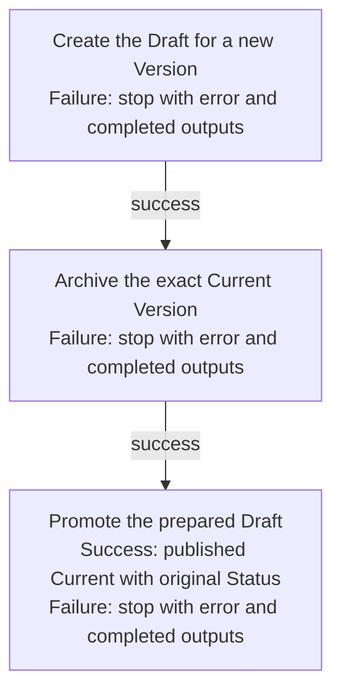

## Summary

Atom Lifecycle_Update Atom

## Claim scope

One non-container Current-backed proposal under the applicable model in PROJECT_CONFIGURATION.

## Claim

This Workflow's Purpose is Runtime.

For one exact Current Atom and requested property changes, capture its Status as `targetStatus` before any effect. It is the publication Status.

Its graph has exactly these three ordered Steps under [CA-R-1570](../../../../CA-SU-11_LAYER_1_CORE_META_MODEL/04_requirement/CA-R-1570-CORE_META_MODEL-RULE--keep-workflow-graphs-separate-from-step-bindings.md):

1. [Create the Draft for a new Version](./CA-O-draft-PROJECT_CONFIGURATION-WORKFLOW--atom-lifecycle-update-atom/CA-O-draft-PROJECT_CONFIGURATION-STEP--create-the-draft-for-a-new-version.md) creates the Draft.
2. [Archive the exact Current Version](./CA-O-draft-PROJECT_CONFIGURATION-WORKFLOW--atom-lifecycle-update-atom/CA-O-draft-PROJECT_CONFIGURATION-STEP--archive-the-exact-current-version.md) archives that Current Atom.
3. [Promote the prepared Draft](./CA-O-draft-PROJECT_CONFIGURATION-WORKFLOW--atom-lifecycle-update-atom/CA-O-draft-PROJECT_CONFIGURATION-STEP--promote-the-prepared-draft.md) promotes the Draft with `targetStatus`.

Each Step binds inputs and runs its named Workflow. On failure, stop before the next Step and return the error with completed outputs under [CA-R-1432](../../../../CA-SU-11_LAYER_1_CORE_META_MODEL/04_requirement/draft/lifecycle-in-place-edits/CA-R-1432@28-draft-CORE_META_MODEL-RULE--classify-admitted-atom-changes-by-semantic-effect.md).

## Details

Promotion derives the Draft's existing identity/version or allocates a fresh canonical ID for a role-only Draft. The published Atom's Status equals `targetStatus`.
